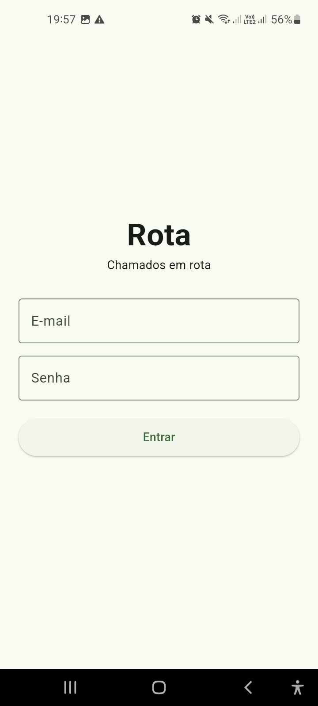
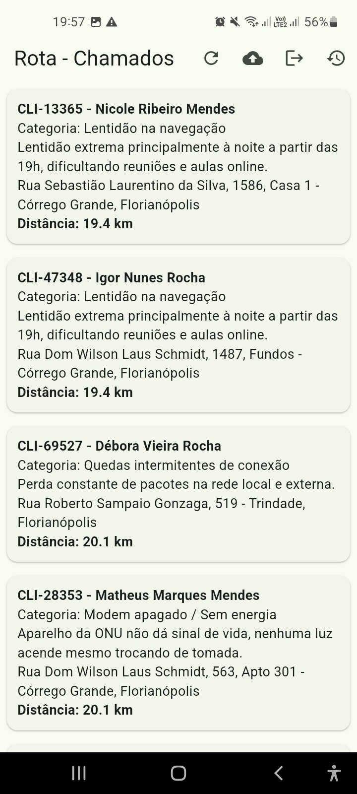
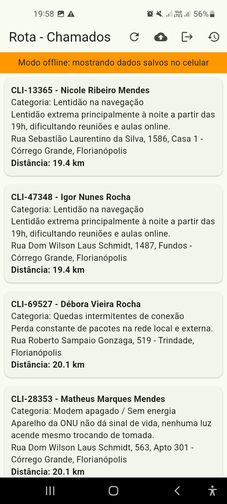
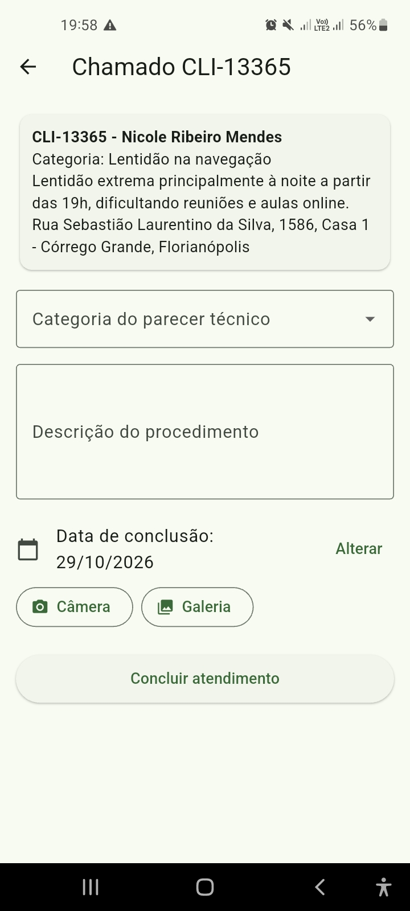
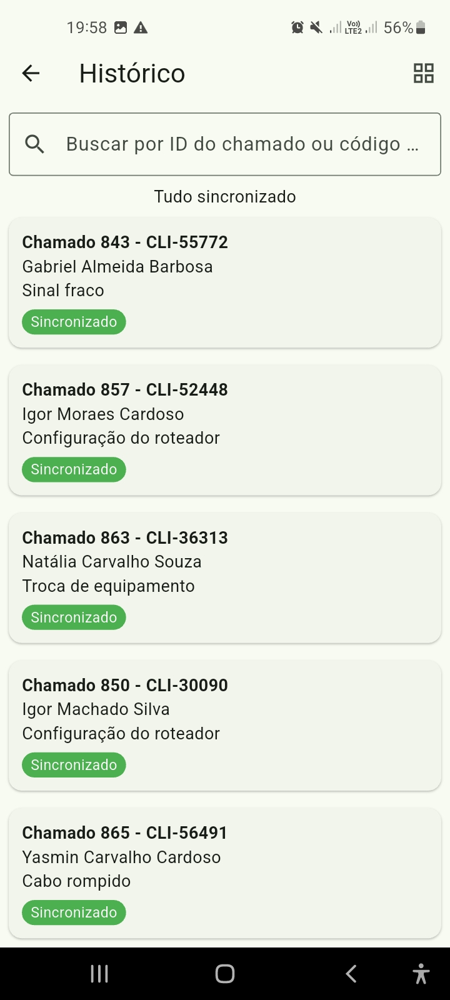
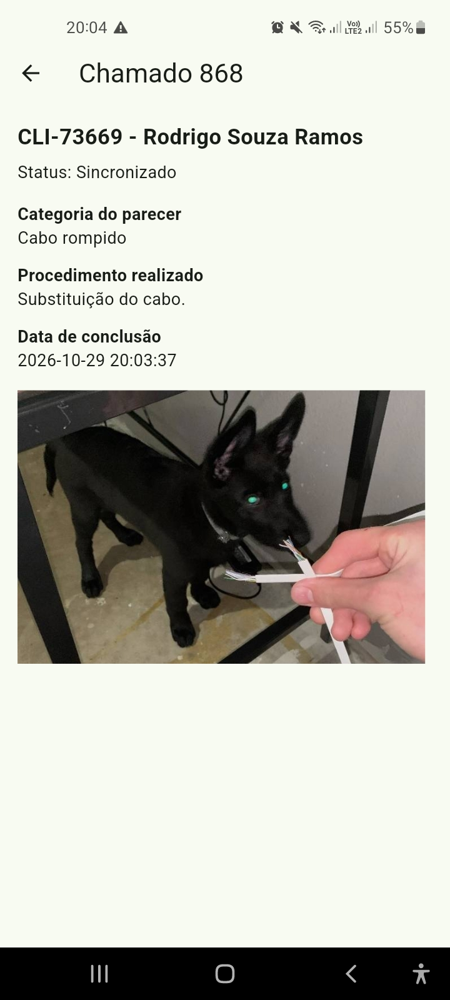

# Rota
**Chamados em rota**

Aplicativo Android em Flutter para técnicos de telecomunicações gerenciarem ordens de serviço em campo, com funcionamento offline-first e sincronização em nuvem.

## Problema que resolve
Técnicos de provedores de internet atuam em áreas sem sinal (subsolos, garagens, zonas rurais). O Rota permite consultar chamados, ordenar por proximidade, registrar o atendimento com foto e enviar tudo depois, quando a internet voltar.

## Funcionalidades
- Login com senha assinada por HMAC-SHA256 e token guardado em `flutter_secure_storage`
- Splash com auto-login
- Carga inicial dos chamados da API para o SQLite
- Home 100% offline com `ListView.builder`, aviso de modo offline e distância em km por GPS
- Lista ordenada do chamado mais próximo ao mais distante
- Formulário de atendimento com validação, foto (câmera ou galeria) e gravação offline
- Sincronização multipart/form-data com Bearer Token; marca como sincronizado após `201 Created`
- Histórico com badge de status, busca em tempo real por ID ou código, alternância lista/grade e foto no detalhe

## Arquitetura (MVVM)

`lib/
`├── main.dart`
`├── data/`
`│   ├── datasources/   (SQLite, API, GPS, foto, armazenamento seguro)`
`│   ├── repositories/  (regras de onde buscar os dados)`
`│   └── models/        (Usuario, Chamado, Atendimento, HistoricoItem)`
`├── viewModel/         (estado das telas, ChangeNotifier)`
`└── view/              (telas)`

A tela conhece só o ViewModel, o ViewModel só o Repository, e o Repository fala com os Datasources.

## Tecnologias
Flutter e Dart, sqflite, http, crypto (HMAC), flutter_secure_storage, geolocator, image_picker, flutter_image_compress, path_provider, mocktail (testes).

## Como executar
1. Instale o Flutter e conecte um celular Android com depuração USB.
2. Clone o repositório e entre na pasta:
   
   git clone https://github.com/fecastilhos22/rota.git
   
3. Instale as dependências e rode:
   
   flutter pub get
   flutter run
   
4. Entre com o e-mail e a senha fornecidos pelo professor.

## Como testar sem internet
1. Entre no app **com internet** e espere a lista de chamados aparecer.
2. Ative o **modo avião** e reinicie o app.
3. A lista continua aparecendo com a faixa laranja de modo offline.
4. Conclua um atendimento (com foto). O chamado sai da lista.
5. Desligue o modo avião e toque no ícone de nuvem para sincronizar.
6. Abra o Histórico e veja o status mudar de "Pendente de Envio" para "Sincronizado".

## Testes

```flutter test```

33 testes: models, datasources, repositories e duas telas (login e atendimento).

## Branches
- `main`: versão final
- `develop`: integração
- `feature/*`: uma por tarefa (estrutura-base, models-e-banco, login-splash, home-chamados, gps-proximidade, atendimento, sincronizacao, historico, testes)

## Telas
   
  

## Vídeo
https://drive.google.com/file/d/1ulMqVj8R_Emi4CCkspVZY3bgzOtjP_V8/view?usp=sharing

## Melhorias futuras
- Sincronização automática ao detectar internet
- Mapa com a rota até o cliente


Projeto final do Módulo 02 - Mobile Flutter - SENAI.
